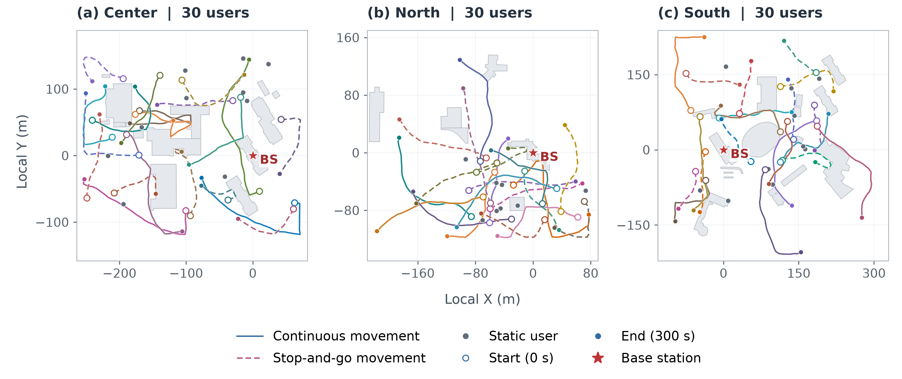

# TKG-DTN: Wireless Network Experiments

[中文使用说明](README_CN.md)

Source code, fixed scenario inputs, and run instructions for the wireless experiments in **TKG-DTN: Temporal Knowledge Graph-Driven Digital Twin Network for 6G Networking**.

This release follows the English experimental manuscript dated **19 October 2026**, *Framework Transfer and Dynamic Service Assurance in Wireless Networks*. It contains the final static and dynamic experiments used in that manuscript.

TKG-DTN represents wireless users, network slices, allocations, and temporal service history in a graph. An LLM agent retrieves network evidence and invokes resource-allocation tools to perform sequential admission or continuous bandwidth adjustment. The experiments use the Center, North, and South HKUST scenarios adapted from WirelessAgent.



*User locations and trajectories over 300 s in the three HKUST scenarios. Each scenario includes stationary, continuously moving, and intermittently moving users.*

## Experiments

The **static sequential-admission experiment** compares TKG-DTN, WirelessAgent, Prompt-based, and Rule-based as 30 users arrive in each scenario. Each method is repeated five times across the three scenarios.

The **dynamic service-assurance experiment** compares TKG-DTN, WirelessAgent, and frozen static allocation over 300 s of user mobility and changing channels. Each agent is repeated five times per scenario; the deterministic frozen baseline is run once per scenario.

Common settings:

- 120 MHz total bandwidth: an isolated 90 MHz eMBB slice and a 30 MHz URLLC slice.
- Paper model: **deepseek-v4-flash**, temperature 0.2. The recorded API request alias is `deepseek-chat`, and responses identify the model as `deepseek-flash`; these are the experiment's API identifiers for the same model.
- The inherited engineering rate mapping is `R = 10 B log10(1 + 10^(CQI/10))`, with bandwidth in MHz and rate in Mbps.
- eMBB per-user bounds: 6–20 MHz and 100–400 Mbps. URLLC bounds: 1–5 MHz and 1–100 Mbps.
- Five repetitions reuse the same inputs and arrival order. Dispersion is the **sample standard deviation across repetitions**, not across individual requests or newly sampled networks.

The static agent methods share the `exact_resources_v2` allocation tools. Prompt-based uses one model call and does not reallocate existing users. Rule-based uses oracle service labels and retains the upstream continuous-bandwidth proportional-fair allocation and fallback; it does not enforce the integer-bandwidth constraint used by the other methods.

Dynamic runs inherit exactly 27, 30, and 29 admitted users in Center, North, and South. Membership and slice assignments stay fixed. Each scenario observes all 30 users, including 10 stationary, 10 continuously moving, and 10 intermittently moving users. The input contains 301 samples at integer seconds from 0 through 300. One-second positions subdivide the original 10-second trajectory segments; geometric channels are recomputed and anchored to the static channel values.

Both agents use completion-driven control. A decision starts at the latest available state; the previous allocation remains in effect during actual API inference. After inference completes, the original candidate is checked against the latest hard resource constraints and applied if valid. A new round starts immediately. Decisions completing beyond 300 s incur model costs but do not change service within the evaluation interval. This is a discrete-event simulation using real API timings, not a physical wireless testbed.

## Main results

In the static experiments, TKG-DTN matches WirelessAgent in slice selection, bandwidth allocation, and service performance while using fewer model calls and tokens and substantially reducing decision latency. These results support the framework’s transfer to wireless network slicing.

In the dynamic experiments, continuous resource adjustment maintains service more effectively than frozen allocation. TKG-DTN improves effective service and long-term fairness compared with WirelessAgent, with the clearest fairness gains in the URLLC slice. Its shorter control rounds enable more frequent adjustments, although this also increases total model usage during continuous operation.

## Repository layout

```text
static/                 Static runner, four policies, resource tools and Neo4j adapter
dynamic/tkg/            TKG-DTN dynamic runner and required runtime modules
dynamic/wireless/       WirelessAgent/frozen runner and required runtime modules
dynamic/data/           Static terminal states used to initialize dynamic runs
data/mobility/          One-second channel and mobility inputs for three scenarios
preparation/            Mobility/channel generation code and source inputs
figures/                Dynamic scenario illustration
requirements.txt        Python dependencies
.env.example            Environment-variable template
```

Static TKG-DTN uses **Neo4j**. Dynamic TKG-DTN uses a local **SQLite temporal graph** and requires no Neo4j server. Each dynamic method retains its own runtime modules to preserve the implementation used in the experiment. `runtime_config.json` supplies the recorded model settings and the source checksums required by the runtime loader.

## Installation

Use Python **3.11**. Clone the repository and install dependencies:

```bash
git clone https://github.com/garvey-chen/TKG-DTN-Wireless.git
cd TKG-DTN-Wireless
python -m venv .venv
source .venv/bin/activate
python -m pip install -r requirements.txt
```

On Windows PowerShell, activate with `.venv\Scripts\Activate.ps1`. The recorded static dependency versions are in `static/requirements-lock.txt`.

## Run new static experiments

The rule baseline needs no API key:

```bash
python static/run.py run --methods rule_upstream --scenarios center north south \
  --users 30 --repeats 5 --arrival-order source --output outputs/static_rule
```

For the full four-method experiment, configure a local Neo4j database and provide credentials through environment variables:

```bash
cp static/configs/neo4j.example.json static/configs/local.neo4j.json
# Edit URI, username and database in the local file as needed.
export WIRELESS_NEO4J_PASSWORD='YOUR_NEO4J_PASSWORD'
export WIRELESS_LLM_API_KEY='YOUR_API_KEY'

python static/run.py run --config static/configs/paper.json \
  --methods tkg_dtn wireless_kb rule_upstream prompt \
  --scenarios center north south --users 30 --repeats 5 --arrival-order source \
  --neo4j-config static/configs/local.neo4j.json --graph-reset none \
  --workers 3 --output outputs/static_new
```

PowerShell equivalents use `$env:WIRELESS_LLM_API_KEY = 'YOUR_API_KEY'` and `$env:WIRELESS_NEO4J_PASSWORD = 'YOUR_NEO4J_PASSWORD'`. The supplied command explicitly preserves existing graph data (`--graph-reset none`), matching the selected batch. Use a dedicated experiment database. `.env.example` lists variable names; scripts do not automatically load that file.

## Run new dynamic experiments

The final runner is selected by method. All commands below use the published static handoff and the same recorded mobility inputs:

```bash
# Deterministic baseline: no API credentials or Neo4j needed.
python dynamic/wireless/run_completion_driven.py --method frozen --scene center \
  --output outputs/frozen_center

# Agents: set WIRELESS_LLM_API_KEY first.
python dynamic/tkg/run_completion_driven.py --method tkg_dtn --scene center \
  --preflight-only
python dynamic/tkg/run_completion_driven.py --method tkg_dtn --scene center \
  --output outputs/tkg_center_r001
python dynamic/wireless/run_completion_driven.py --method wireless_agent --scene center \
  --output outputs/wireless_center_r001
```

Repeat agent commands for `north` and `south` and for five distinct output directories per scenario. Run frozen once per scenario. Existing dynamic output directories are refused. Each agent run performs real, billable model calls. Fresh API latency and generation can differ, so new runs are not expected to reproduce every recorded number exactly. Dynamic paper runners deliberately retain the archived API model settings; the archived settings must be explicitly changed and documented for a different backend/model.

The public rerun uses the supplied handoff from the selected static runs. Replacing it with new static results defines a new experiment and requires regenerating and validating the handoff.

## Regenerate mobility inputs

```bash
python preparation/generate_mobility_1s.py --output outputs/mobility_regenerated
```

This reconstructs the final 1 s positions and anchored channels from the supplied original 10 s trajectories. It preserves user identities, initial positions/requests, and movement/pause schedules. Scenario CSVs can be checked against `data/mobility/{center,north,south}.csv`; generation metadata changes with the output path and software environment. This command is not a redraw of randomly sampled trajectories.

## Metric definitions and scope

- **Static qualified users:** correct service slice and feasible per-user/slice-pool resources. Static resource-feasible throughput includes feasible users even if their selected slice is wrong.
- **Dynamic effective user-time:** sum of effective service durations divided by `30 × 300 s` per scenario. Unadmitted users remain in the denominator.
- **Dynamic throughput:** integrate modeled rate over exact telemetry/completion intervals, then divide by 300 s. Effective throughput additionally requires service-class and resource compliance.
- **Fairness:** within each fixed admitted service-class cohort, normalize delivered traffic in a sliding window by the minimum guaranteed traffic, then compute Jain's index. Average windows within a run, scenarios within a repeat, then repeats. Wrong-slice users remain in the fixed cohort.
- **Control latency:** measured policy/model/tool wall time, distinct from radio packet latency. The simulation treats host telemetry replay and physical commit bookkeeping as instantaneous.
- **Tokens:** API-reported input plus output tokens, including cached input. Values are token counts, not monetary prices.

The experiments evaluate framework adaptation and simulated service assurance. They do not measure packet-level latency, wireless hardware, handover or interference. Shared resource tools explain the observed static decision agreement; efficiency differences compare the complete adapted agent implementations and do not isolate graph representation alone.

## Attribution

WirelessAgent code and datasets are adapted from [WirelessAgent](https://github.com/jwentong/WirelessAgent_R1). Maps retain [OpenStreetMap contributor attribution](https://www.openstreetmap.org/copyright). See [THIRD_PARTY_NOTICES.md](THIRD_PARTY_NOTICES.md) for source and licensing information.

Reference used by the manuscript:

> J. Tong, W. Guo, J. Shao, Q. Wu, Z. Li, Z. Lin, and J. Zhang, “WirelessAgent: Large language model agents for intelligent wireless networks,” *China Communications*, vol. 23, no. 3, pp. 265–285, 2026. DOI: 10.23919/JCC.fa.2025-0163.202603.

If using these experiments, cite the TKG-DTN manuscript and the WirelessAgent reference.
